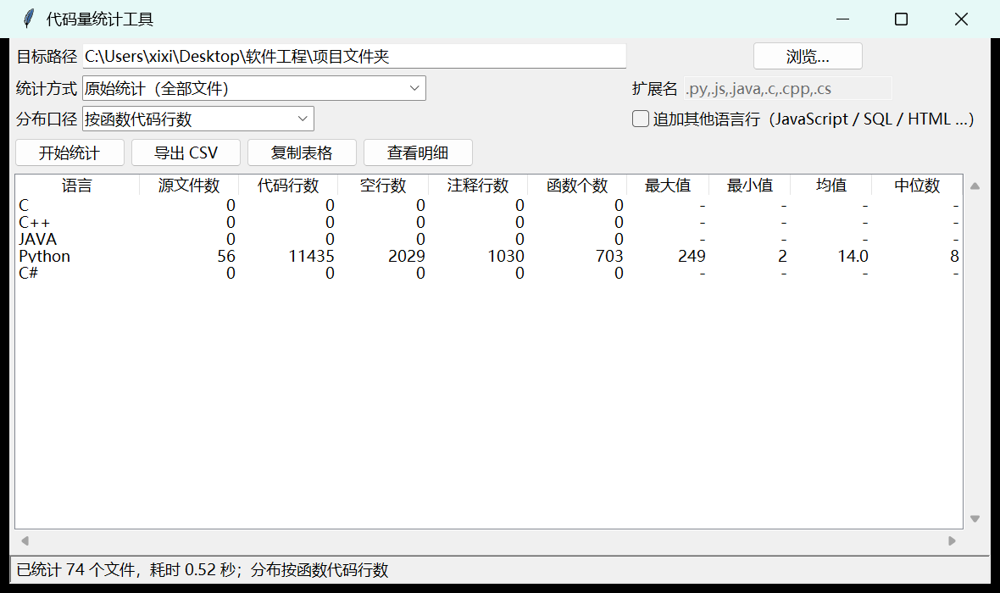

# 代码量统计工具



统计多语言项目的代码规模：按语言给出文件数、有效代码行、空行、注释行，并进一步统计**函数个数**与
**单个函数代码行数的最大值 / 最小值 / 均值 / 中位数**。纯 Python 标准库实现，不依赖任何第三方包，
既能在命令行直接出表，也有 tkinter 图形界面。

目录里有两个工具，一个负责"数行"，一个负责"出表"：

| 文件 | 作用 | 怎么用 |
|------|------|--------|
| `cloc.py` | 行数统计内核 + 命令行（文件数 / 空行 / 注释 / 代码行，40+ 种语言） | `python cloc.py <路径>` |
| `code_stats.py` | 在其上补齐**函数个数**与**代码行分布**，按测试用例的表格格式输出，带图形界面 | 双击或 `python code_stats.py` |

`code_stats.py` 直接 `import cloc` 复用后者的语言表、读文件、数行与忽略规则，所以两个工具
的口径完全一致：同样的目录、同样的 `.clocignore`，行数一定对得上。

---

## 快速开始

```bash
# 图形界面（输入路径、选统计方式，点「开始统计」）
python code_stats.py

# 命令行直接出表
python code_stats.py ../../四则运算项目

# 只统计手写代码（读 .clocignore 排除文档与生成内容）
python code_stats.py . -m hand
```

---

## 一、图形界面

```powershell
cd "C:\Users\xixi\Desktop\软件工程\项目文件夹"
python 代码量统计工具\code_stats.py          # 不带参数就打开界面
```

界面上从上到下四步：

1. **目标路径** —— 可直接粘贴，也可点「浏览…」选目录；
2. **统计方式** —— 三选一：
   - `原始统计（全部文件）`：除了缓存目录，什么都不排除；
   - `手写口径（按 .clocignore 排除生成内容）`：读目标目录下的 `.clocignore`，
     把文档、生成数据、生成脚本排掉；
   - `仅指定扩展名`：右侧填 `.py,.js` 这样的列表，只统计这些。
3. **分布口径** —— 决定表格最后四列怎么算：
   - `按函数代码行数`：每个函数的行数分布（默认）；
   - `按文件代码行数`：每个文件的行数分布。
4. 点 **开始统计**，下面出表。

按钮：

- **导出 CSV** —— `utf-8-sig` 编码，Excel 双击打开中文不乱码；
- **复制表格** —— 制表符分隔，直接粘到 Word / Excel 就是一个现成的表格；
- **查看明细** —— 每个文件的代码行、空行、注释、函数个数；先选中某一行再点，
  就只看那个语言。

高 DPI 屏幕（缩放 125%/150%）下界面已做 DPI 适配，不会糊。

---

## 二、表格格式

列与 `testcase3_测试结果` 的模板一一对应：

| 列 | 含义 |
|----|------|
| 语言 | C / C++ / JAVA / Python / C#，其他语言（JavaScript、SQL、HTML…）用「追加其他语言行」勾选后跟在后面 |
| 源文件数 | 该语言参与统计的文件数（内容完全相同的文件只算一份） |
| 代码行数 | 含代码的行（行尾注释也算代码行） |
| 空行数 | 纯空行 |
| 注释行数 | 整行只有注释 |
| 函数个数 | 见下方「函数识别口径」 |
| 最大值 / 最小值 / 均值 / 中位数 | **默认是「单个函数代码行数」的分布**；把分布口径切成「按文件」就是每个文件代码行数的分布 |

没有文件的固定语言行会显示 `0`，四列统计显示 `-`。

`.h` / `.hpp` 头文件并入 **C++** 行（cloc 里叫 `C/C++ Header`、`C++ Header`）。

---

## 三、函数识别口径

| 语言 | 识别方式 | 准确度 |
|------|----------|--------|
| Python | `ast` 解析 `def` / `async def`，含类方法、嵌套函数 | 精确 |
| C / C++ / Java / C# | 启发式：`名字 + 参数表 + 函数体 {}`，大括号配对定位函数体；跳过 `if/for/while/switch/catch` 等控制结构、排除 `new Xxx()` 初始化、构造器初始化列表、`throws` 子句、泛型 `<>`、箭头函数 | 高（对常规写法） |
| JavaScript / TypeScript | 同上，另识别 `const f = (a) => {...}` 箭头函数与 `function f(){}` | 高 |
| SQL | 只认 `CREATE FUNCTION` / `CREATE PROCEDURE` | 精确 |
| HTML / CSS / Markdown / JSON 等 | 不统计函数（显示 0） | — |

已知不覆盖的写法：C 的 K&R 极简宏、C++ 的 `operator` 重载（按关键字跳过不计数）、
复杂宏生成的函数。这些不会让统计报错，只是可能少计一两个，手工核对时留意即可。

---

## 四、命令行

```powershell
python 代码量统计工具\code_stats.py <路径> [选项]
```

| 参数 | 说明 | 例子 |
|------|------|------|
| `path` | 目标目录或文件；不给就开界面 | `code_stats.py "四则运算项目"` |
| `-m, --mode` | `raw` 原始 / `hand` 手写口径 / `ext` 仅指定扩展名 | `-m hand` |
| `-e, --ext` | 扩展名列表（给了 `-e` 但没写 `-m` 会自动按 `ext` 处理） | `-e .py,.js` |
| `-d, --distribution` | `func` 按函数（默认）/ `file` 按文件 | `-d file` |
| `--no-others` | 只输出五行模板语言 | `--no-others` |
| `--csv` | 同时导出 CSV | `--csv out.csv` |
| `--gui` | 强制开界面 | `--gui` |

示例输出：

```
语言      源文件数  代码行数  空行数  注释行数  函数个数  最大值  最小值  均值  中位数
--------------------------------------------------------------------------------------
C                0         0       0         0         0       -       -     -       -
C++              0         0       0         0         0       -       -     -       -
JAVA             0         0       0         0         0       -       -     -       -
Python          29      5346    1044       393       441     103       2  10.6       7
C#               0         0       0         0         0       -       -     -       -

统计目录：四则运算项目
已统计 30 个文件；最大值/最小值/均值/中位数 = 单个函数代码行数的分布
耗时 0.084 秒
```

---

## 五、`.clocignore`：只算手写代码

把 `clocignore.example` 复制到**要统计的目录根部**，改名为 `.clocignore`，按需增删。
规则写法（每行一条）：

```
.md                            # 裸扩展名：跳过所有 .md
*.json                         # 通配扩展名
data.sql                       # 文件名：跳过任何目录下叫 data.sql 的
gen_report.py                  # 文件名
教务管理系统/tools/gen_er.py    # 相对路径：只跳这一个
output/                        # 目录前缀：跳过整个目录
```

`cloc.py` 也会自动读取**统计根目录**下的 `.clocignore`，两个工具共用同一份清单。

工具目录里现成的那份示例对应"只算手写"的口径：排掉 `.md`、`data.sql`、
四个生成脚本、`output/`、`__pycache__/`。

---

## 六、已知限制

- 内容完全相同的文件只算一份（沿用了 `cloc.py` 的去重行为，暂未提供开关）；
- 超过 5MB 的文件、前 8KB 含 NUL 字节的二进制文件会跳过；
- 扩展名不在语言表里的文件（如 `.ipynb`、`.vue` 之外的新格式）不会计入，也不报错；
- 函数行数 = 结束行 − 起始行 + 1，包含函数体内的空行与注释；
- 均值保留 1 位小数，中位数可能是 `.5`。
